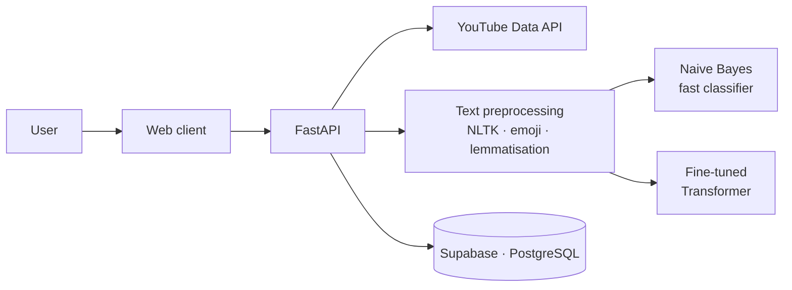

<h1 align="center">🛡️ Toxic Comment Detection on YouTube — NLP & Transformers</h1>

<p align="center">
  Full-stack system that pulls comments from any YouTube video and classifies them as toxic or not,<br/>
  combining a fast classical ML model with a fine-tuned Transformer.
</p>

<p align="center">
  
  
  
  
  
  
  
  
</p>

<p align="center">
  📚 <a href="https://resonant-hotteok-331ed1.netlify.app/"><b>Technical documentation (live)</b></a>
</p>

---

## 🎯 The problem

Moderating comments by hand doesn't scale: popular videos receive thousands of comments, and toxic ones damage communities and brands. This project automates the first filter so moderators only review what matters.

## ✨ Features

- **YouTube Data API v3 integration** — paste a video URL and analyse its comments
- **Two-model approach**
  - *Fast path*: Multinomial Naive Bayes + text vectorisation for cheap, instant classification
  - *Deep path*: fine-tuned **Transformer** for contextual analysis
- **Experiment tracking with MLflow** (accuracy, F1, precision, recall per run)
- **FastAPI** backend, **Supabase/PostgreSQL** persistence via SQLAlchemy
- **Fully containerised** with Docker Compose
- **Docs as code**: MkDocs Material site built automatically by GitHub Actions

## 🧠 Transformer comparison

Four Transformers fine-tuned and benchmarked on the same toxic-comment dataset (4,645 test comments):

| Model | Accuracy | F1 | Precision | Recall | Test loss | Training time |
|---|---|---|---|---|---|---|
| **DeBERTa-v3-small** | **0.839** | 0.848 | **0.852** | 0.844 | **0.468** | 533 s |
| RoBERTa | 0.838 | **0.848** | 0.843 | **0.854** | 0.481 | 630 s |
| BERT-base | 0.832 | 0.842 | 0.842 | 0.843 | 0.624 | 630 s |
| DistilBERT | 0.832 | 0.842 | 0.841 | 0.842 | 0.559 | **344 s** |

**Takeaway:** DeBERTa-v3-small gave the best accuracy and lowest test loss while training ~15% faster than BERT-base and RoBERTa. DistilBERT is the cheapest option with only a ~0.6-point drop in F1.

## 🏗️ Architecture



## 👤 My role

Team project of 5 at the Factoría F5 AI Bootcamp. I owned the **Transformer track**:

- Built the benchmark notebook and **fine-tuned DeBERTa, RoBERTa, BERT and DistilBERT** with PyTorch + Hugging Face
- Evaluated and compared them (accuracy, F1, precision, recall, loss, training time) and saved the model and tokenizer for serving
- Experimented with **model quantization** to reduce size and inference time
- Integrated the Transformer into the serving pipeline and fixed the **Docker** images for the backend

## 🚀 Run it locally

```bash
git clone https://github.com/mr-melenas/toxic-comments-nlp.git
cd toxic-comments-nlp

# Create .env with: SUPABASE_URL, SUPABASE_KEY, YOUTUBE_API_KEY, DATABASE_URL
docker-compose up --build
# API → http://localhost:8000/docs   ·   Frontend → http://localhost:5173
```

## 📁 Project structure

```
Notebook/      # EDA, Naive Bayes, SVM, Keras, PyTorch and Transformer notebooks
Models/        # serialised models (Naive Bayes, Transformer tokenizer/config…)
server/        # FastAPI app, preprocessing pipeline, database layer
client/        # web frontend
docs/          # MkDocs documentation
```

## 🔭 Next steps

- Public demo on Hugging Face Spaces
- Multilingual model (Spanish + English comments)

## 👥 Team

Built at [Factoría F5](https://factoriaf5.org/) by [@mr-melenas](https://github.com/mr-melenas) (Max Beltrán), [@jdomdev](https://github.com/jdomdev), [@Jorgeluuu](https://github.com/Jorgeluuu), [@mikewig](https://github.com/mikewig) and [@abbyenredes](https://github.com/abbyenredes).
Original team repository: [Bootcamp-IA-P4/project-x-nlp-team-3](https://github.com/Bootcamp-IA-P4/project-x-nlp-team-3).
